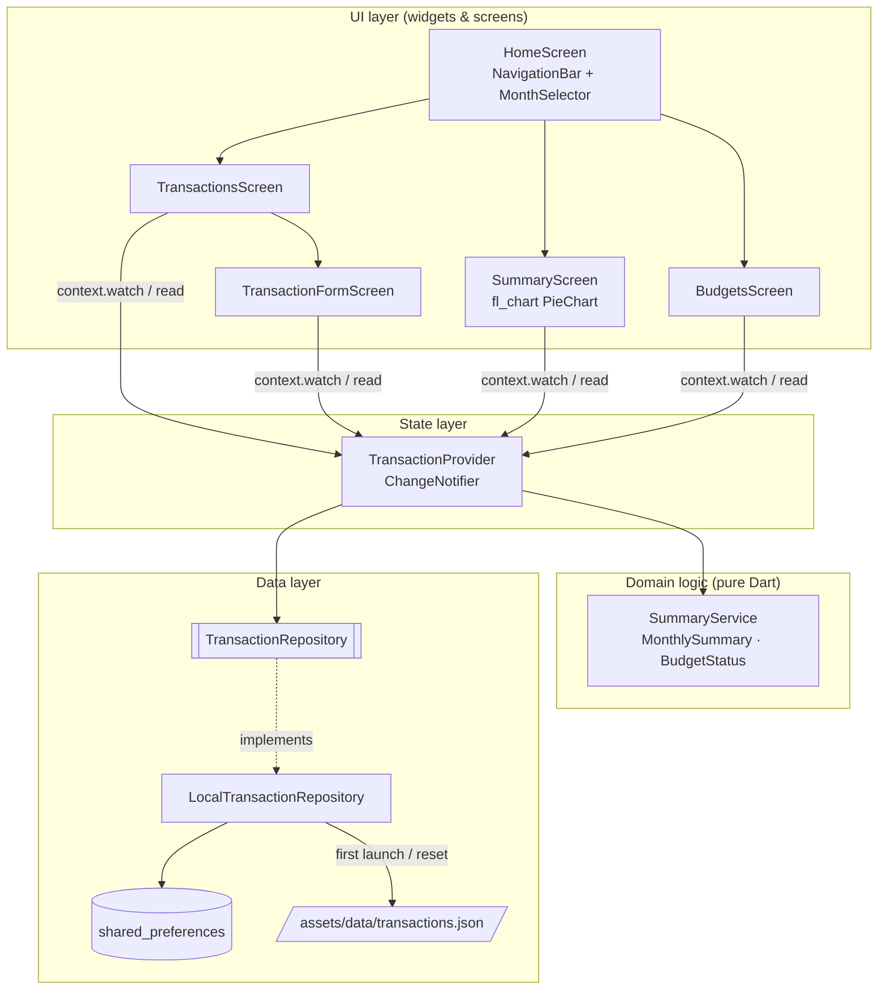

# Expense Tracker (Flutter)

A Material 3 personal finance app for tracking income and expenses, visualising monthly spending and staying within per-category budgets.

> **Note:** This is a demo / learning project. All bundled data is fictional and the app stores everything locally on the device. It is not meant for real financial record keeping.

## Features

- **Transactions list grouped by day**, with "Today" / "Yesterday" headers and a daily net total
- **Add, edit and delete** transactions (swipe to delete with *Undo*, or delete from the edit screen)
- **12 built-in categories** (9 expense, 3 income), each with its own icon and colour
- **Monthly summary**: income, expenses, net, savings rate and a month-over-month comparison
- **Interactive donut chart** (fl_chart) of spending by category. Tap a slice to see its amount
- **Budgets per category** with green / amber / red progress bars, an "over by $X" warning and an overall budget meter
- **Filters**: switch month (arrows or month picker) and filter the list by category chips
- **Local persistence** with `shared_preferences`; seeded on first launch from a bundled JSON file
- **"Reset sample data"** menu action to restore the demo data at any time
- Light and dark theme that follow the system setting

## Tech stack

| Concern            | Choice                                              |
| ------------------ | --------------------------------------------------- |
| UI                 | Flutter 3.27+, Dart 3.6+ (null-safe), Material 3     |
| State management   | [`provider`](https://pub.dev/packages/provider) (`ChangeNotifier`) |
| Persistence        | [`shared_preferences`](https://pub.dev/packages/shared_preferences) (JSON) |
| Charts             | [`fl_chart`](https://pub.dev/packages/fl_chart)     |
| Formatting         | [`intl`](https://pub.dev/packages/intl)             |
| IDs                | [`uuid`](https://pub.dev/packages/uuid)             |
| Lints / tests      | `flutter_lints`, `flutter_test`                     |

## Project structure

```
expense-tracker-flutter/
├── assets/data/transactions.json   # 81 fictional seed transactions (Jul–Sep 2026)
├── lib/
│   ├── main.dart                   # Bootstraps SharedPreferences + Provider
│   ├── app.dart                    # MaterialApp, light/dark Material 3 themes
│   ├── data/
│   │   ├── default_categories.dart # Category list (icons, colours) + lookups
│   │   └── default_budgets.dart    # Budgets applied on first launch
│   ├── models/
│   │   ├── transaction.dart        # Transaction + TransactionType, JSON mapping
│   │   └── transaction_category.dart
│   ├── services/
│   │   ├── summary_service.dart    # Pure logic: summaries, budgets, grouping
│   │   └── transaction_repository.dart # Storage interface + shared_preferences impl
│   ├── state/
│   │   └── transaction_provider.dart   # ChangeNotifier holding app state
│   ├── screens/
│   │   ├── home_screen.dart        # Scaffold, NavigationBar, month selector
│   │   ├── transactions_screen.dart
│   │   ├── transaction_form_screen.dart
│   │   ├── summary_screen.dart
│   │   └── budgets_screen.dart
│   ├── widgets/                    # Reusable UI pieces (tiles, chart, dialogs…)
│   └── utils/                      # Formatters, validators, semantic colours
├── test/                           # Unit tests (summary, budgets, provider, model)
├── analysis_options.yaml
└── pubspec.yaml
```

## Architecture



**Design notes**

- `SummaryService` contains all of the money maths (totals, category breakdowns, budget levels, grouping) as pure static functions. This makes it easy to unit test and keeps widgets thin.
- `TransactionRepository` is an interface. The app uses `LocalTransactionRepository`, and tests use an in-memory fake, so you could swap in Hive, SQLite or a REST backend without touching the UI.
- The provider updates memory and calls `notifyListeners()` *before* persisting, so swipe-to-delete removes the row immediately while the write happens in the background.
- Amounts are always stored as positive numbers. The sign comes from `TransactionType`, and totals are rounded to cents to avoid floating-point noise.

## Setup & run

Prerequisites: [Flutter SDK](https://docs.flutter.dev/get-started/install) 3.27 or newer (Dart 3.6+).

The repository contains only the Dart sources. The platform folders (`android/`, `ios/`, `web/`, …) are **not** committed, so you need to generate them once:

```bash
cd expense-tracker-flutter

# 1. Generate platform folders (keeps existing lib/, test/ and pubspec.yaml)
flutter create . --project-name expense_tracker --platforms android,ios,web

# 2. Install dependencies
flutter pub get

# 3. Run on a connected device, emulator or Chrome
flutter run
```

Useful commands:

```bash
flutter analyze        # static analysis using analysis_options.yaml
flutter test           # run unit tests
flutter test --coverage
```

No environment variables or API keys are required.

## Sample data

`assets/data/transactions.json` holds **81 fictional transactions** from **July to September 2026** for a made-up person:

- Monthly salary from "Brightline Labs" plus occasional freelance invoices
- Rent at "Maple Court Apt 4B", utilities (power, internet, mobile)
- Groceries, dining out, transport, entertainment, shopping and health expenses spread across each month
- A few one-offs (weekend trip, birthday gift, selling an old bike)

Default budgets (in `lib/data/default_budgets.dart`) are set so that the demo shows a mix of healthy, near-limit and over-budget categories. On first launch the seed data is copied into `shared_preferences`; after that, your edits are what's stored. Use **⋮ → Reset sample data** to start over.

The app opens on the current month. If that month has no transactions, it opens on the latest month that does, so the demo data is visible straight away.

## Tests

| File | Covers |
| ---- | ------ |
| `test/summary_service_test.dart` | Monthly totals, category breakdown, filtering, day grouping, month helpers |
| `test/budget_status_test.dart` | Budget levels (healthy / warning / exceeded / unbudgeted), ordering, totals |
| `test/transaction_provider_test.dart` | Loading, month navigation, filters, CRUD + persistence, budgets, reset |
| `test/transaction_model_test.dart` | JSON round-trip and validation of the bundled seed file |
| `test/formatters_validators_test.dart` | Currency/date formatting and amount parsing |

## Future improvements

- Custom user-defined categories and icons
- Recurring transactions (rent, subscriptions) and reminders
- Multi-currency support with locale-aware formatting
- Migrate storage to Hive/Isar or SQLite (drift) for larger data sets
- CSV import/export and cloud backup
- Trend charts (spending over 6–12 months) and search
- Widget and golden tests for the main screens; integration tests with `integration_test`
- Localisation (ARB files) and accessibility audit

## License

[MIT](LICENSE)
